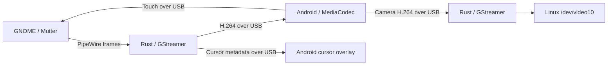

# Architecture

Extraspace has a Rust host and a Kotlin Android companion. The host creates or
captures a GNOME display, encodes its frames, and sends them through three
ADB-forwarded sockets. The tablet decodes video, renders the cursor, and sends
touch events and optional camera frames back.



## Crates

| Crate | Responsibility |
|---|---|
| `xs-proto` | Frame headers and message definitions, mirrored by Android's `Protocol.kt` |
| `xs-mutter` | Display creation, monitor layouts, input injection, and the patched-Mutter check |
| `xs-video` | PipeWire capture, cursor metadata, frame pacing, and H.264 encoding |
| `xs-transport` | ADB orchestration, companion installation, and framed sockets |
| `xs-camera` | Decode the tablet camera stream into a V4L2 loopback device |
| `xs-core` | Session lifecycle and adaptive bitrate control |
| `xs-ui` | GTK4/libadwaita interface and persisted user settings |

## GNOME session setup

For an extended display, the host:

1. Creates a RemoteDesktop session and reads its session ID.
2. Creates a ScreenCast session linked to that RemoteDesktop session. This link
   makes injected touch coordinates relative to the captured stream.
3. Calls `RecordVirtual` with `is-platform: true` and cursor metadata enabled.
4. Subscribes to `PipeWireStreamAdded` before starting the RemoteDesktop session.
5. Connects the capture pipeline to the PipeWire node, then finalizes the virtual
   monitor's layout.

A linked session starts through RemoteDesktop. Starting ScreenCast directly is
rejected by Mutter. Closing the virtual display restores the physical monitor
layout while preserving changes made during the session.

Mirror mode records an existing monitor instead of creating a virtual one.

## Capture and rendering

The preferred capture path requests DMA-BUF frames and passes GPU-backed buffers
through GStreamer to a VA-API encoder:

```text
PipeWire -> appsrc -> drop-only frame pacing -> vapostproc -> VA-API H.264 -> USB
```

When GPU encoding is unavailable, the host uses copied frames with
`videoconvert` and x264 or OpenH264. Encoder bitrate units are normalized in
`xs-video::encoder`.

Cursor position and bitmap metadata travel separately on the control channel.
Android draws that cursor over a `TextureView`, while MediaCodec handles video.
Pointer movement therefore does not need to produce another encoded frame.

Mutter produces frames when the desktop changes. Frame pacing drops excess
frames instead of filling idle periods with duplicates. The Android decoder has
a separate output-drain thread so the final frame can render even when no new
input arrives.

The video socket waits until `MediaCodec.start()` completes before delivering its
first access unit. Control configuration is posted to Android's main thread;
receiving `VideoConfig` on the control socket alone does not mean the decoder is
ready. Losing the first SPS/PPS and keyframe can leave the decoder waiting for the
next keyframe and inflate its reported queue depth.

## Scaling and compositor guards

The default path divides the tablet panel dimensions by the selected scale,
rounds to even dimensions, and lets Android upscale the video.

With `XS_MUTTER_MODES=1`, a recorded patched Mutter build can instead create a
near-native framebuffer and apply a GNOME logical scale. Dimensions are trimmed
so the logical size stays integral.

`xs-mutter::patched` checks the recorded package version against pacman's local
database and checks whether GNOME Shell is still using a replaced library.
Without a matching patch marker, scaled modes remain disabled. The patches,
installation hook, and rollback instructions live in
[packaging/mutter-patch](../packaging/mutter-patch/README.md).

## Integration examples

Unit tests need neither a tablet nor GNOME. These manual examples require an
active GNOME Wayland session and exercise real capture or virtual displays:

```bash
cargo run -p xs-core --example fake_tablet
cargo run --release -p xs-core --example resolution_bench
cargo run -p xs-video --example capture_test
cargo run -p xs-mutter --example virtual_monitor
```

`fake_tablet` performs the handshake, consumes video, reports decoder health, and
sends touch events through real sockets. It exercises the host pipeline but does
not verify USB transport or Android's decoder.

`resolution_bench` uses the real tablet and emits JSON measurements. Close the
desktop app first; `XS_BENCH_SECONDS` bounds the run. The current resolution
decision and its measurement limits are in the
[resolution benchmark](resolution-benchmark.md).

See the [engineering notes](engineering-notes.md) for earlier hardware results
and the capture, encoder, and ADB behavior that motivated this design.

## Live color diagnostics

While the desktop app is running, this action saves its latest encoded keyframe
and a graph containing the negotiated pipeline caps. It does not reconnect the
tablet. Use a directory that does not already exist:

```bash
gdbus call --session \
  --dest io.github.tymonoman.Extraspace \
  --object-path /io/github/tymonoman/Extraspace \
  --method org.gtk.Actions.Activate \
  save-video-diagnostic "[<'/tmp/extraspace-video-sample'>]" '{}'

ffprobe -v error -show_streams /tmp/extraspace-video-sample/frame.h264
```

The snapshot contains desktop pixels. The directory is private to your account,
and files are only written when the action is requested. The saved frame is the
latest keyframe, which may precede the request if the desktop has been idle.
