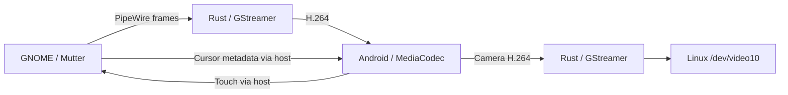

# Architecture

Extraspace has a Rust host and a Kotlin Android companion. The host creates or
captures a GNOME display and sends H.264 video and cursor metadata. The tablet
decodes video, draws the cursor, and returns touch input and optional camera
video. Control, display video, and camera video use separate framed channels
over ADB or native authenticated Wi-Fi.



## Crates

| Crate | Responsibility |
|---|---|
| `xs-proto` | Frame headers and messages, mirrored by Android's `Protocol.kt` |
| `xs-mutter` | Display creation, monitor layouts, input injection, and compositor checks |
| `xs-video` | PipeWire capture, cursor metadata, frame pacing, and H.264 encoding |
| `xs-transport` | ADB orchestration, companion installation, native Wi-Fi, and framed sockets |
| `xs-camera` | Decode tablet camera video into a V4L2 loopback device |
| `xs-core` | Session lifecycle, recovery, telemetry, and adaptive bitrate |
| `xs-ui` | Application lifetime, exported controls, GTK settings, and persistence |

## Application lifetime

`xs-ui::controller` owns the engine and cached session state. It exports
GApplication actions on the session bus at `io.github.tymonoman.Extraspace`,
`/io/github/tymonoman/Extraspace`. Display, scale, mode, image quality, and
pairing controls work without a settings window. Read-only `display-enabled`
and `session-state` actions distinguish the requested state from the actual
connection state.

The GNOME 51 extension watches the bus name and action changes. It starts the
host through installed desktop actions and has no idle polling timer. Video
and networking run in the host process, outside GNOME Shell.

| Launch | Behavior |
|---|---|
| Ordinary launch | Open the window and use the saved auto-connect preference |
| `--background` | Start the display without constructing a window |
| `--settings` | Open settings without starting the display |
| `--pair` | Open pairing and enable connections |

Closing settings keeps an enabled display running. When the display is off,
closing settings quits. Off and Quit wait for engine shutdown before exiting,
releasing capture, sockets, and discovery. A settings-only host rejects incoming
Wi-Fi data channels until the display is enabled.

## GNOME session setup

For an extended display, the host:

1. Creates a RemoteDesktop session and reads its ID.
2. Creates a ScreenCast session linked to RemoteDesktop, making injected touch
   coordinates relative to the captured stream.
3. Calls `RecordVirtual` with `is-platform: true` and cursor metadata enabled.
4. Subscribes to `PipeWireStreamAdded`, then starts RemoteDesktop.
5. Connects capture to the PipeWire node and finalizes the monitor layout.

Mutter rejects starting a linked session through ScreenCast directly. Closing
the virtual display restores physical monitor layouts while preserving changes
made during the session. Mirror mode records an existing monitor instead.

## Video and cursor

The preferred path imports GPU-backed PipeWire buffers into a VA-API pipeline:

```text
PipeWire DMA-BUF -> appsrc -> drop-only pacing -> vapostproc -> VA-API H.264 -> transport
```

The software path copies frames and uses `videoconvert` with x264 or OpenH264.
`xs-video::encoder` normalizes their different bitrate units. Android decodes
through MediaCodec into a `TextureView` and draws the cursor as an overlay.
Cursor updates travel on the control channel without requiring another video
frame.

Capture follows desktop changes. Excess raw frames can be dropped before
encoding; idle periods do not generate duplicate frames. The bounded encoded
channel preserves H.264 references and propagates backpressure to the one-frame
leaky raw-input queue. Shutdown closes the encoded channel before stopping
GStreamer so a blocked encoder callback can exit.

Imported DMA-BUF memory retains its dequeued PipeWire buffer until the last
GStreamer memory reference is released. The destructor sends a generation token
to the capture loop, which requeues only buffers that still belong to the
stream. Duplicating a file descriptor alone would not prevent pixel reuse.

The video socket waits for `MediaCodec.start()` before delivering its first
access unit. Android drains output on a separate thread, including when no new
input arrives. Input saturation waits briefly for capacity; a persistent stall
reconnects with a fresh decoder rather than losing an encoded reference frame.

## Scaling and compositor checks

In Extend mode, Sharper requests a near-native framebuffer with GNOME logical
scaling. Dimensions are trimmed to make logical sizes integral. The
`SessionConfig.native_resolution` preference is independent of the selected
scale. Quality, mode, and scale changes recreate the display while retaining
the selected tablet and transport.

Standard divides panel dimensions by the scale and lets Android enlarge the
video. Mirror mode uses the captured monitor's dimensions. The app falls back
to Standard when `scaled_modes_supported()` cannot verify the patched
compositor. The legacy `XS_MUTTER_MODES=1` flag applies only to standalone
Mutter diagnostic examples.

The compatibility check compares the recorded patch marker with pacman's local
database and looks for a replaced library still mapped by GNOME Shell. See
[patch installation and rollback](../packaging/mutter-patch/README.md).

## Native Wi-Fi and trust

The host listens on TCP port 47471, using an available port if occupied, and
advertises `_extraspace._tcp.local.` through DNS-SD. Android discovers it with
NSD and also tries its last working endpoint. The tablet opens three TLS 1.3
connections for control, video, and camera. USB and Wi-Fi share framing and
codec behavior.

The GUI enables pairing for five minutes with a one-use 100-bit code, displayed
as five groups of four characters and as a QR code. The QR includes certificate
fingerprint and endpoint information. Manual entry discovers candidates without
trusting their advertisements. Pairing uses HMAC-SHA256 proofs over the server
certificate fingerprint and fresh nonces, with separate client/server domains.
The code itself is not sent over the network.

Android verifies the server proof before releasing a random 256-bit credential;
the host verifies the client proof before saving its hash. Later channels must
present that credential inside TLS, and Android pins the saved certificate.
Android encrypts its credential with an app-specific Android Keystore AES-GCM
key. The host stores its certificate, private key, and approved credential
hashes in `~/.config/extraspace/wireless.json`, respecting `XDG_CONFIG_HOME`,
with 0600 file and 0700 directory permissions.

Updates retain trust. Forgetting a device removes trust and closes its active
session. Native Wi-Fi uses no ADB service or cloud relay. Transport tests cover
real TLS, unknown credentials, persistence, three-channel assembly, and
revocation. Roaming and sleep/wake remain unverified integration scenarios.

## Android lifecycle and reconnects

`onStart` creates discovery and local USB listeners. `onStop` closes discovery,
in-flight TLS attempts, channels, decoder, and camera; it releases the multicast
lock and removes timers. Saved credentials remain on disk. Generation guards
reject callbacks from previous sessions, including connections completing after
Home. QR scan results wait until the display activity resumes.

USB teardown shuts down blocked accepts before closing file descriptors.
Binding happens off the main thread with a short retry window. Each connection
reports disconnect once, and generation guards prevent stale channel closures
from tearing down a replacement connection. The host returns to waiting after
a control disconnect while the visible tablet app retries.

Touch and health reports use a bounded output worker, keeping TLS writes off
Android's main thread. The worker stops when the activity is hidden. The screen
stays awake only while connected. USB can explicitly launch the activity through
ADB; native Wi-Fi cannot wake a hidden app.

## Integration examples

These commands require an active GNOME Wayland session:

```bash
cargo run -p xs-core --example fake_tablet
cargo run --release -p xs-core --example resolution_bench -- --help
cargo run -p xs-video --example capture_test
cargo run -p xs-mutter --example virtual_monitor
```

`fake_tablet` handshakes, consumes video, reports decoder health, and sends touch
through real sockets. It does not verify USB or Android decoding.
`resolution_bench` uses a real tablet; see [benchmark reproduction](benchmarks/sharpness.md#reproduction).
Hardware-free lifecycle checks are in [Contributing](../CONTRIBUTING.md#checks).

## Video diagnostics

Save the latest encoded keyframe and negotiated pipeline graph without
reconnecting. Choose a directory that does not exist:

```bash
gdbus call --session \
  --dest io.github.tymonoman.Extraspace \
  --object-path /io/github/tymonoman/Extraspace \
  --method org.gtk.Actions.Activate \
  save-video-diagnostic "[<'/tmp/extraspace-video-sample'>]" '{}'

ffprobe -v error -show_streams /tmp/extraspace-video-sample/frame.h264
```

The private directory contains desktop pixels. Files are written only on
request. The latest keyframe may predate the request if the desktop is idle.
Additional recording and stall diagnostics are documented with the
[sharpness benchmark](benchmarks/sharpness.md#reproduction).
