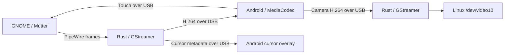

# Architecture

Extraspace has a Rust host and a Kotlin Android companion. The host creates or
captures a GNOME display, encodes its frames, and sends them through three
independent channels over USB or authenticated Wi-Fi. The tablet decodes video, renders the cursor, and sends
touch events and optional camera frames back.



## Crates

| Crate | Responsibility |
|---|---|
| `xs-proto` | Frame headers and message definitions, mirrored by Android's `Protocol.kt` |
| `xs-mutter` | Display creation, monitor layouts, input injection, and the patched-Mutter check |
| `xs-video` | PipeWire capture, cursor metadata, frame pacing, and H.264 encoding |
| `xs-transport` | ADB orchestration, companion installation, and framed sockets |
| `xs-camera` | Decode the tablet camera stream into a V4L2 loopback device |
| `xs-core` | Session lifecycle and adaptive bitrate control |
| `xs-ui` | Application lifetime, exported controls, optional GTK settings, and persisted settings |

## Background application and Quick Settings

`xs-ui::controller` owns one engine and cached session/telemetry state. Controls
are exported as GApplication actions on the session bus at
`io.github.tymonoman.Extraspace`, `/io/github/tymonoman/Extraspace`.
`set-display`, `set-scale`, `set-mode`, and the pairing actions work without a
settings window. Read-only `display-enabled` and `session-state` actions expose
requested display use and actual connection state separately.

The GNOME 51 extension in `extension/` watches that bus name and action changes.
Its tile uses installed desktop actions to start the process on demand. It has
no idle polling timer and never runs video or networking code inside Shell.
`--background` starts the display without constructing a window; `--settings`
opens settings without starting the display; `--pair` opens pairing and enables
connections. Ordinary launches retain the window and auto-connect behavior.

Closing settings hides it while the display is enabled. When disabled, closing
settings quits. Off and Quit wait for engine shutdown and then exit the process,
releasing capture, sockets, and discovery. A settings-only process rejects
incoming Wi-Fi data channels until Connect is requested; pairing remains explicit.

The hardware-free lifecycle check uses a private bus and a virtual display:

```bash
GSETTINGS_BACKEND=memory GSK_RENDERER=cairo GTK_A11Y=none \
  dbus-run-session -- xvfb-run -a python3 scripts/test-background.py target/release/extraspace
node extension/tests/state.mjs
```

## GNOME session setup

For an extended display, the host:

1. Creates a RemoteDesktop session and reads its session ID.
2. Creates a ScreenCast session linked to that RemoteDesktop session. This link
   makes injected touch coordinates relative to the captured stream.
3. Calls `RecordVirtual` with `is-platform: true` and cursor metadata enabled.
4. Subscribes to `PipeWireStreamAdded` before starting the RemoteDesktop session.
5. Connects the capture pipeline to the PipeWire node, then finalizes the virtual
   monitor's layout.

A linked session starts through RemoteDesktop. Starting ScreenCast directly is
rejected by Mutter. Closing the virtual display restores the physical monitor
layout while preserving changes made during the session.

Mirror mode records an existing monitor instead of creating a virtual one.

## Capture and rendering

The preferred capture path requests DMA-BUF frames and passes GPU-backed buffers
through GStreamer to a VA-API encoder:

```text
PipeWire -> appsrc -> drop-only frame pacing -> vapostproc -> VA-API H.264 -> USB
```

When GPU encoding is unavailable, the host uses copied frames with
`videoconvert` and x264 or OpenH264. Encoder bitrate units are normalized in
`xs-video::encoder`.

Cursor position and bitmap metadata travel separately on the control channel.
Android draws that cursor over a `TextureView`, while MediaCodec handles video.
Pointer movement therefore does not need to produce another encoded frame.

Mutter produces frames when the desktop changes. Frame pacing drops excess
frames instead of filling idle periods with duplicates. The Android decoder has
a separate output-drain thread so the final frame can render even when no new
input arrives.

The video socket waits until `MediaCodec.start()` completes before delivering its
first access unit. Control configuration is posted to Android's main thread;
receiving `VideoConfig` on the control socket alone does not mean the decoder is
ready. Losing the first SPS/PPS and keyframe can leave the decoder waiting for the
next keyframe and inflate its reported queue depth.

## Scaling and compositor guards

The default path divides the tablet panel dimensions by the selected scale,
rounds to even dimensions, and lets Android upscale the video.

With `XS_MUTTER_MODES=1`, a recorded patched Mutter build can instead create a
near-native framebuffer and apply a GNOME logical scale. Dimensions are trimmed
so the logical size stays integral.

`xs-mutter::patched` checks the recorded package version against pacman's local
database and checks whether GNOME Shell is still using a replaced library.
Without a matching patch marker, scaled modes remain disabled. The patches,
installation hook, and rollback instructions live in
[packaging/mutter-patch](../packaging/mutter-patch/README.md).

## Integration examples

Unit tests need neither a tablet nor GNOME. These manual examples require an
active GNOME Wayland session and exercise real capture or virtual displays:

```bash
cargo run -p xs-core --example fake_tablet
cargo run --release -p xs-core --example resolution_bench
cargo run -p xs-video --example capture_test
cargo run -p xs-mutter --example virtual_monitor
```

`fake_tablet` performs the handshake, consumes video, reports decoder health, and
sends touch events through real sockets. It exercises the host pipeline but does
not verify USB transport or Android's decoder.

`resolution_bench` uses the real tablet and emits JSON measurements. Close the
desktop app first; `XS_BENCH_SECONDS` bounds the run. The current resolution
decision and its measurement limits are in the
[resolution benchmark](resolution-benchmark.md).

See the [engineering notes](engineering-notes.md) for earlier hardware results
and the capture, encoder, and ADB behavior that motivated this design.

## Live color diagnostics

While the desktop app is running, this action saves its latest encoded keyframe
and a graph containing the negotiated pipeline caps. It does not reconnect the
tablet. Use a directory that does not already exist:

```bash
gdbus call --session \
  --dest io.github.tymonoman.Extraspace \
  --object-path /io/github/tymonoman/Extraspace \
  --method org.gtk.Actions.Activate \
  save-video-diagnostic "[<'/tmp/extraspace-video-sample'>]" '{}'

ffprobe -v error -show_streams /tmp/extraspace-video-sample/frame.h264
```

The snapshot contains desktop pixels. The directory is private to your account,
and files are only written when the action is requested. The saved frame is the
latest keyframe, which may precede the request if the desktop has been idle.

## Native Wi-Fi and saved trust

The desktop app listens on TCP port 47471 (or an available port if occupied)
while open, and advertises `_extraspace._tcp.local.` through DNS-SD. Android's
NSD finds it; the last successful endpoint is also tried when discovery fails.
The tablet opens three TLS 1.3 connections, preserving separate control, video,
and camera channels. The codec and framing stay the same as USB.

Pairing is explicitly enabled in the desktop GUI for five minutes. A fresh,
one-use 100-bit code is shown as a QR and as five groups of four characters.
The QR also includes the certificate fingerprint and current endpoints. Manual
entry discovers candidate laptops but does not trust their advertisements.
The pairing exchange uses HMAC-SHA256, with separate client/server domains,
over the server certificate fingerprint and fresh nonces from both endpoints.
Android verifies the server proof before releasing a newly generated 256-bit
credential; the host requires the client proof before saving its hash. The code
is never sent over the network. Codes are deliberately longer than six digits
to resist offline guessing without requiring a password protocol.

Subsequent channels require the saved credential inside TLS; Android requires
the exact saved certificate. Credentials and video are never sent to a server
with an unverified identity. Android encrypts the credential with an app-specific
AES-GCM key in Android Keystore. The host saves its certificate, private key,
and approved credential hashes in `~/.config/extraspace/wireless.json` (0600,
within a 0700 directory), respecting `XDG_CONFIG_HOME`. App updates retain trust;
forgetting a device removes trust and closes its active session. No ADB service
is involved in native Wi-Fi, and no service stays running after Extraspace exits.

Transport tests exercise real TLS, rejected unknown credentials, persistence,
three-channel assembly, and rejection after revocation. On the SM-X510, live
checks covered GUI pairing, retaining trust across an APK upgrade, two desktop
close/reopen cycles without restarting the tablet process, reopening the tablet,
and reopening both apps with the desktop first. Each reconnected without a
Connect press or repeated pairing. Network changes still need separate testing.

USB listener teardown explicitly shuts down blocked accepts before closing
their file descriptors. Binding happens off the main thread with a brief retry
window, and each connection reports a disconnect only once. Session-generation
guards discard stale callbacks so simultaneous channel closures cannot tear
down a new connection. The desktop detects a lost control channel and returns
to its waiting screen while the Android client retries automatically.

Android connection resources follow the visible activity lifecycle. `onStart`
creates a fresh discovery client and resumes the local listeners; `onStop`
closes discovery and in-flight TLS attempts, releases the multicast lock, closes
all channels, stops the decoder and camera, and removes the statistics timer.
Saved credentials remain encrypted on disk. Generation guards reject callbacks
from a previous visible session, including a connection completing after Home.
The QR scanner is a separate activity: its result is queued until the display
activity starts again. The display keeps the screen awake only while connected;
waiting uses the normal Android timeout. USB's explicit ADB activity launch is
independent of these resources and does not require a resident app listener.

Live foreground/background checks on the SM-X510 covered two Home/return
cycles in the same process: Home left no `xs-*` worker threads, released the
`extraspace-discovery` multicast lock and closed the three TLS channels.
Opening the desktop app over native Wi-Fi while the tablet app remained hidden
did not wake it. Returning to the tablet app restored all three channels without
pairing again. Touch and health-report writes use a bounded control-output
worker, rather than performing TLS writes on Android's main thread; that worker
is also stopped when the activity is hidden.
